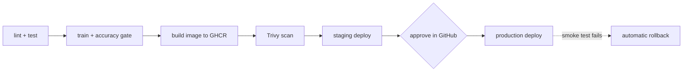

# MLOps Pipeline: Classifier on Kubernetes

[](https://github.com/hskhalsa1990/mlops-k8s-pipeline/actions/workflows/ci.yml)
[](LICENSE)


An end-to-end CI/CD reference for serving a Keras classifier on Kubernetes. A
[GitHub Actions](https://docs.github.com/actions) workflow tests, trains, gates, builds, scans and
deploys the model to staging, then to production after manual approval, with autoscaling,
monitoring and automatic rollback. The whole project is a flat repository: no source subfolders.

**Contents:** [Highlights](#highlights) · [Quick start](#quick-start) · [Pipeline](#pipeline) ·
[API](#api) · [Security](#security) · [Operations](#operations) · [Setup](#setup-on-github) ·
[Configuration](#configuration) · [Repository layout](#repository-layout) · [Before production](#before-production)

## Highlights
- **Quality gate:** a model below `MIN_ACCURACY` never becomes an image.
- **Traceable artifacts:** commit SHA, dataset fingerprint, model card and metrics for every build.
- **Secure by default:** non-root, read-only filesystem, dropped capabilities, NetworkPolicy, optional API key.
- **Safe delivery:** staging first, manual approval for production, automatic rollback on failed rollout or smoke test.
- **Observable:** Prometheus metrics, Grafana dashboard, drift signals and runbook-backed alerts.



## Quick start
```bash
make install && make train && make run
curl -s localhost:8080/health/ready
curl -s -X POST localhost:8080/v1/predict -H 'Content-Type: application/json' \
  -d "{\"features\": [$(python -c 'print(",".join(["0.0"]*20))')]}"
```

| Command | Purpose |
| --- | --- |
| `make ci` | Lint and tests (same as CI) |
| `make test` | Tests with coverage (no trained model required) |
| `make train` | Train, write `model/`, apply the accuracy gate |
| `make run` / `make docker-run` | Serve locally, or in a hardened container |
| `make audit` / `make load-test` | Dependency scan / latency check |
| `make manifests` | Render the Kustomize manifests |
| `make lint-infra` | `shellcheck` and `hadolint` (optional local tools) |
| `make docs-check` | Verify that relative Markdown links resolve |
| `make help` | List all targets |

## Pipeline
Defined in `ci.yml` (GitHub reads it from `.github/workflows/ci.yml`, see [Setup](#setup-on-github)).

| Job | What happens |
| --- | --- |
| `lint-test` | `ruff` lint and format check, `pytest` with coverage |
| `sast`, `secret-scan`, `dependency-audit`, `validate-manifests`, `lint-shell-docker` | `bandit`, `gitleaks`, `pip-audit` (advisory), `kubeconform`, `shellcheck` and `hadolint` in parallel |
| `train` | Validates the dataset, trains, logs to MLflow, writes `model/metadata.json` and `reports/` (per-class report, confusion matrix, model card); fails below `MIN_ACCURACY` (default 0.80) |
| `build-image` | Builds with Docker Buildx and pushes to GitHub Container Registry (GHCR), tagged with the commit SHA and `latest`, `main` only |
| `image-scan` | Trivy reports HIGH/CRITICAL findings; fixable CRITICAL findings always block |
| `deploy-staging` | Applies the manifests with staging settings, waits for rollout, smoke-tests a real prediction, rolls back on failure |
| `deploy-production` | Waits for approval in the `production` environment, then deploys the same image |
| `release` (on tag) | Generates a CycloneDX SBOM and creates a GitHub release with it attached |

Deploy jobs run only when the repository variable `ENABLE_DEPLOY` is `true`, so the project works as a
portfolio piece without a cluster.

## API
| Endpoint | Purpose |
| --- | --- |
| `POST /v1/predict` | `{"features": [20 floats]}` returns `{"class", "confidence", "model_version"}` |
| `POST /v1/predict/batch` | `{"instances": [[20 floats], ...]}`, up to `MAX_BATCH_SIZE` (64) rows |
| `GET /v1/model/info` | Version, accuracy and training metadata of the loaded model |
| `GET /version` | Build and model version |
| `GET /health/live`, `/health/ready`, `/health` | Liveness, readiness (503 until the model loads), legacy status |
| `GET /metrics` | Prometheus metrics |
| `GET /docs` | Interactive OpenAPI documentation |

Model endpoints live under `/v1`; the unversioned paths (`/predict`, `/predict/batch`, `/model/info`) remain as
legacy aliases and are hidden from the OpenAPI docs. Health, version and metrics endpoints are unversioned.

Inputs are validated (exactly 20 finite floats per row). Every response carries an `X-Request-ID`
header and logs are structured JSON.

## Security
- **Authentication:** optional `X-API-Key` on the model endpoints (`/v1/predict`, `/v1/predict/batch`, `/v1/model/info`); probes and `/metrics` stay open.
  `kubectl create secret generic ml-api-secret --from-literal=api-key=<value> -n <namespace>`
- **Request hardening:** security headers, body size cap (`MAX_BODY_BYTES`, 413; enforced for chunked uploads too), per-client rate limiting (`RATE_LIMIT_PER_MIN`, 429 with `Retry-After`; keys are stored hashed).
- **Container and cluster:** multi-stage image, UID 10001, read-only root filesystem, all capabilities dropped, seccomp default, no service-account token, NetworkPolicy; optional egress lockdown and `ResourceQuota`.
- **Supply chain:** `gitleaks`, `bandit`, `pip-audit`, Trivy, `kubeconform`, SBOM per release, Renovate updates.
- **Governance:** `CODEOWNERS`, pull request template, [security policy](SECURITY.md).

## Operations
- **Scaling:** HPA with scale-down stabilization owns the replica count; PodDisruptionBudget and topology spread across nodes.
- **Environments:** `deploy.sh` applies the same manifests with per-namespace settings (staging: 1-3 replicas, DEBUG logs; production: 3-20 replicas, INFO logs). Override with `HPA_MIN`, `HPA_MAX`, `LOG_LEVEL`.
- **Monitoring:** `monitoring-servicemonitor.yaml`, `monitoring-prometheusrule.yaml` (target down, model not loaded, p95 latency, 5xx rate, error-budget burn, drift, no traffic) and `grafana-dashboard.json`.
- **Drift signals:** `predict_confidence` histogram and `predict_input_zscore_mean_abs` (inputs versus the training scaler).
- **Exposure:** the Service is `ClusterIP`; use `k8s-optional-ingress.yaml` (TLS, rate limit) or `kubectl port-forward`.
- **Incident response:** see the [runbook](RUNBOOK.md) and [SLOs](SLO.md); design notes in [architecture](ARCHITECTURE.md) and [decision records](DECISIONS.md).

## Setup on GitHub
1. Create an empty repository and push these files.
2. **Place the workflow where GitHub looks for it.** On GitHub choose *Add file > Create new file*, name it
   `.github/workflows/ci.yml`, paste the contents of `ci.yml` and commit. With git instead:
   `mkdir -p .github/workflows && git mv ci.yml .github/workflows/ci.yml`.
3. In *Settings > Actions > General > Workflow permissions* allow read access; the jobs request `packages: write` themselves.
4. The first image push creates a package under *Packages*. Make it public, or give the cluster an image pull secret.
5. Optional, to deploy to a cluster:
   - Variable `ENABLE_DEPLOY` = `true` (*Settings > Secrets and variables > Actions > Variables*).
   - Secret `KUBECONFIG_B64` (`base64 -w0 kubeconfig`) in the `staging` and `production` environments.
   - *Settings > Environments > production*: add **Required reviewers** (this is the manual approval).
   - The cluster API must be reachable from GitHub-hosted runners, or use a self-hosted runner.
6. Optional: install the Renovate app for dependency updates (`renovate.json`).

## Configuration
| Setting | Where | Default | Effect |
| --- | --- | --- | --- |
| `MIN_ACCURACY` | `train` job in `ci.yml` | 0.80 | Minimum test accuracy to proceed |
| `TRIVY_EXIT_CODE` | repository variable | 0 | `1` fails the pipeline on HIGH/CRITICAL findings |
| `ENABLE_DEPLOY` | repository variable | unset | `true` turns on the staging and production jobs |
| `ENABLE_MONITORING` | deploy jobs in `ci.yml` | true | Apply ServiceMonitor and alert rules (needs Prometheus Operator) |
| `continue-on-error` | `dependency-audit` job | on | Remove to make dependency findings blocking |

Runtime settings (`LOG_LEVEL`, `MAX_BATCH_SIZE`, `MAX_BODY_BYTES`, `RATE_LIMIT_PER_MIN`) live in the `ml-api-config` ConfigMap.

## Repository layout
The repository is flat; only `.github/workflows/` is a folder, because GitHub requires it.
```text
predict.py, train.py, data_validation.py, model_card.py   inference API, training, dataset checks, model card
test_*.py, conftest.py                                    pytest suite
check_metrics.py, check_docs.py, load_test.py, deploy.sh  accuracy gate, link check, load test, deploy
k8s-*.yaml, kustomization.yaml                            Kubernetes manifests (k8s-optional-* applied by hand)
monitoring-*.yaml, grafana-dashboard.json                 ServiceMonitor, alert rules, dashboard
ci.yml                                                    GitHub Actions workflow (move to .github/workflows/)
ARCHITECTURE.md, RUNBOOK.md, SLO.md, DECISIONS.md         documentation
Dockerfile, Makefile, requirements*.txt, ruff.toml        build and tooling
```

## Troubleshooting
| Symptom | Likely cause |
| --- | --- |
| No workflow runs after pushing | `ci.yml` is still in the repository root; move it to `.github/workflows/ci.yml` |
| `train` fails | Accuracy below `MIN_ACCURACY`, or dataset validation failed; download the `reports` artifact |
| `build-image` fails on `COPY model/` | The `train` job did not produce the `model` artifact |
| Deploy jobs are skipped | Repository variable `ENABLE_DEPLOY` is not `true` |
| Pod stuck in `ImagePullBackOff` | The GHCR package is private and the cluster has no pull secret |
| Pod never becomes ready | `model/` missing from the image; check `kubectl logs` for "model artifacts not found" |
| Deploy rolled back | Rollout or smoke test failed; the job log shows which one |
| Every request returns 401 | `ml-api-secret` is set but the client sends no `X-API-Key` |

## Before production
- Replace `make_classification` in `train.py` with your real dataset; the reported metrics come from synthetic data.
- Run `make format` once so `ruff format --check` passes, then confirm `make ci` is green locally.
- Pin the base images and CI actions you rely on (ideally by digest) and add the secrets and variables above.

## Project docs
[Architecture](ARCHITECTURE.md) · [Runbook](RUNBOOK.md) · [SLOs](SLO.md) · [Decisions](DECISIONS.md) · [Contributing](CONTRIBUTING.md) · [Security policy](SECURITY.md) · [Changelog](CHANGELOG.md)

## License
MIT. Copyright (c) 2026 H. S. Khalsa. See [LICENSE](LICENSE).
